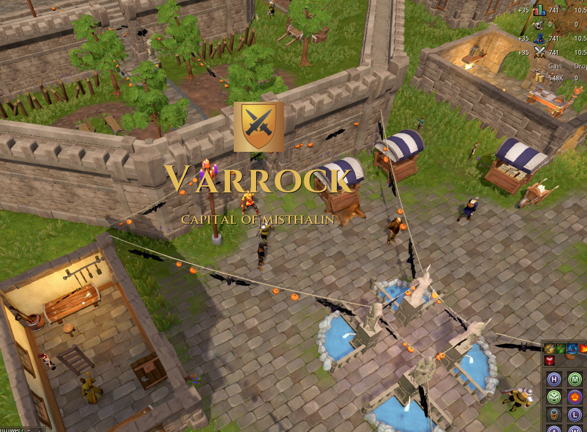

# Area Names

A RuneScape 3 plugin that announces where you are, like the area titles in the Souls games: when you walk into a town, cross into another kingdom or arrive somewhere by teleport, its name fades in across the screen.



## Features

- **Places, kingdoms and instances.** Walking into a place (a town, an island, a dungeon) shows it, with its own subtitle or the kingdom it's in. Crossing into another kingdom shows the kingdom. Worlds of their own like War's Retreat, boss fights and heists have their own titles too.
- **Lodestone shields** above the names of areas that have one.
- **No titles during loading screens.** After a teleport, the title waits until the loading screen is over, then shows where you arrived.
- **No repeats when walking back in.** Stepping out of a place and straight back in doesn't show its title again for a while (see Settings). Arriving by teleport always shows it.

## Settings

The plugin's page (its ribbon icon) has the most used ones: **Font**, **Font size**, **Play a sound**, **Preview** (the title for where you are now, or an example when that's nowhere named), and **Open settings** for the rest. The settings window has three tabs:

- **Text**: **Font**, **Font size** (greyed out for fonts that come in just one size), **Colour** with a **Custom colour** picker, **Show shields** (the lodestone shield above the name), **Height on screen**, how long the title takes to **fade in**, **stays** and takes to **fade out**, and the **Delay after teleport** (how long titles wait after a teleport so they don't play under its loading screen; 0 shows them at once, for when loading screens are off).
- **Sound**: **Play a sound**, **Stop the sound with the title** (cuts it off when the title is gone; the game can't fade a playing sound, so it's a hard stop, and it's off by default so sounds play to the end), **Play the death jingle on death** (when you respawn in Death's Office, whatever the other sound settings; the game plays its own death jingle only with music on, so with music on you'd hear both), a **Play** button, and every **Sound** to pick from (picking one plays it). Needs the game's sound effects turned on.
- **Areas**: which kinds of area get titles (kingdoms, places, boss fights, heists), **Repeat titles after**: how long before an area's title shows again when you walk back in (0 shows it every time), and a checkbox for every kingdom, place, boss fight and heist. Untick one to stop its title; inside an unticked place, a bigger place around it shows instead. All of these are saved between sessions.

Dev builds also have a **Map borders** tab on the plugin's page, a debug tool for mapping areas, see [Mapping areas](#mapping-areas).

## Contributing areas

New areas, better borders and fixes to the ones there are very welcome. All of them are in [`src/game/world_areas.lua`](src/game/world_areas.lua). Positions are **world tiles** (a map square is 64 of them), the `x` and `z` of the player's `coordGrid`.

There are three kinds:

- **Places** are anything with a name of its own: towns, islands, dungeons, worlds of their own like War's Retreat, and the places instances are copied from. Each is an outline: its corners in order, as `{ x, z }` tiles. Places nobody has traced yet are circles instead: a middle and a radius in tiles. The title shows when you're inside, with the place's subtitle, or without one, the kingdom it's in. You only count as having left 5 tiles outside, so walking along the edge doesn't show it again and again. Where places overlap, the smallest wins, so the Grand Exchange shows inside Varrock.

  ```lua
  { name = "Varrock", subtitle = "Capital of Misthalin", sprite = "THAS_SHIELD_VARROCK", points = { { 3175, 3380 }, { 3270, 3380 }, { 3270, 3505 }, { 3175, 3505 } } },
  { name = "Grand Exchange", at = { 3165, 3487 }, radius = 20 },
  ```

- **Kingdoms** are an outline (`points`, like a place's) or one or more rectangles, each `{ min x, min z, max x, max z }`. Their title shows when you cross into one outside any place. Like places, you only count as having left a kingdom with an outline 5 tiles past its edge. Where kingdoms overlap, the first one in the list wins, so put a kingdom before a neighbour whose border reaches over it.

  ```lua
  { name = "Karamja", sprite = "THAS_SHIELD_KARAMJA", points = { { 2987, 2878 }, { 3020, 3020 }, ... } },
  ```

- **Instances** are named by their **instance id** (`world_areas.instances`): the game's `BOSS_INSTANCE_CURRENT_BOSS` while you're in one. For bosses it's their Reaper task id (`BSLAY_ID`), and heists have their own (500 and 501). An instance with a known id wins over places and kingdoms. Some bosses only set it once the fight starts.

  ```lua
  [30] = { name = "Solak", subtitle = "Guardian of the Grove" },
  ```

`subtitle` and `sprite` are optional for all of them. `sprite` is a name from the game's sprites (`id.Sprite`); the lodestone shields are the `THAS_SHIELD_...` ones.

## Mapping areas

All kingdoms and most places are traced outlines. These are the tools for tracing and checking them. They're in `src/mapping`, which only dev builds have.

### Seeing the borders

The plugin's **Map borders** tab is for this. Tick **Show area borders**, then tick the kingdoms and places you want to see. None are ticked at first, as drawing them all is slow. Each area is drawn in its own colour, the same one every time:

- on the ground around you, in the main world (not in instances);
- on [Better World Map](#better-world-map)'s map, if you've set it up as below, with each area's name at its middle.

### Better World Map

Better World Map by jadefx is a world map plugin. With a few additions, your copy of it draws Area Names' borders on its map and lets you trace an outline by clicking on it. The additions, and how to set them up, are in [`tools/better-world-map`](tools/better-world-map/README.md).

### Tracing an outline on the map

1. Build both plugins (`./build.sh` and `tools/better-world-map/build.sh`), and tick **Show area borders**.
2. Open the map with **M** and find the area.
3. **Ctrl+click** each corner in turn. **Ctrl+Shift+click** removes the last corner, and **Ctrl+Alt+click** starts over. The corners are drawn in magenta.
4. Each click prints the outline so far to the chat, ready to paste:

   ```
   [Area Names] { name = "New place", points = { { 2987, 2878 }, { 3020, 3020 }, ... } },
   ```

5. Paste it into `world_areas.lua`, rename it and add its subtitle and sprite. Rebuild, tick the area on the **Map borders** tab and check it on the map and on the ground.

The clicks give real tiles even where the map shows a region moved away from its real place (Havenhythe, Prifddinas, Anachronia), using Better World Map's own map data.

Tips:

- Trace neighbouring kingdoms so their edges meet. A gap between them is in no kingdom, and an overlap goes to whichever comes first in the list.
- Islands like Crandor and Mos Le'Harmless belong to no kingdom; leave them outside the outlines around them.
- Smaller places win inside bigger ones, so a town can be traced around the Grand Exchange without cutting it out.
- Copy the printed line as text rather than retyping it; long outlines are easy to get a digit wrong in.

### Tracing in game

To trace by walking instead, press **Mark corner** on the **Map borders** tab at each corner. Each press prints the outline so far the same way. **Undo corner** removes the last corner, and **Clear corners** starts over. The corners you've marked are drawn in white, on the ground and on Better World Map's map.

### Finding coordinates

**Mark corner** on the **Map borders** tab prints the tile you're standing on. In an instance, that's the tile it was copied from, which is the one to use for a place.

The [RuneScape Wiki](https://runescape.wiki) lists coordinates for many locations too. A few wiki pages (like Misthalin, Fremennik Province and the Grand Exchange) have an `{{Area map}}` outline in their infobox, whose points can be copied as they are. Careful with coordinates from the wiki though: the wiki's map (like the world map) shows some places moved away from their real tiles. Havenhythe's wiki coordinates are 704, 1792 more than its real ones, and Prifddinas and Anachronia are moved too. The tile **Mark corner** prints is always the real one.

## Shields

The lodestone shields (`THAS_SHIELD_...`) come with a separate alpha mask (`..._ALPHA`) that the game applies itself, but plugins can't, so shown as they are they have a gradient out to their square edges. The plugin ships merged copies in `resources/shields/` and shows those instead; shields without one fall back to the game's sprite.

To add one:

1. Export the shield and its mask as PNGs, for example with the [RuneApps model viewer](https://runeapps.org/modelviewer). Name them after the sprite without `THAS_SHIELD_`, in lower case: `varrock.png` and `varrock_alpha.png`.
2. Put them in `debug/shields/` and run:

   ```sh
   cd tools/shields
   npm install
   node merge.cjs
   ```

   This writes `resources/shields/THAS_SHIELD_VARROCK.png`.
3. Rebuild, and restart the game client: it only finds new files in `resources/` when it starts, so reloading the plugin isn't enough.

## Building

```sh
./build.sh           # copies the plugin (main.lua, plugin.json, src, resources) into Area-Names/
./build.sh release   # for publishing, without the mapping tools (src/mapping)
```

To also copy dev builds into your game's `dev_plugins` folder, create `build.local.sh` (it's gitignored) with:

```sh
dev_plugins_dir="$HOME/path/to/RuneScape-BETA/dev_plugins"
```

The plugin depends on the [prettyui](https://prettyui.j3.gg/) plugin (see `plugin.json`).

## Licence

Public domain ([The Unlicense](LICENSE)): do whatever you want with the code.
